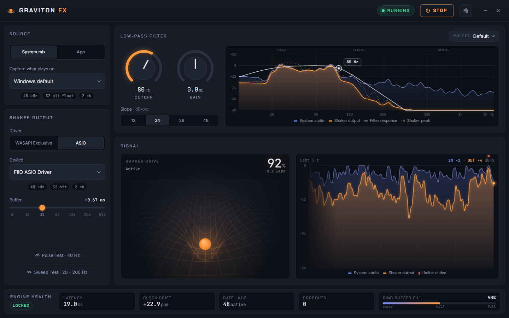

# Graviton FX

**Bass shaker driver for Windows.** Graviton FX takes the sound your PC is already playing, keeps only the bass, and sends it to a separate audio device that drives a bass shaker (tactile transducer), with as little delay as possible.



> **Status:** released. Download the latest version from the [Releases](https://github.com/deuter0n/GravitonFX/releases) page. Its specs are in [`openspec/specs/`](openspec/specs/), and the plan it was built from is in [`openspec/changes/archive/`](openspec/changes/archive/2026-11-23-build-graviton-fx/).

## What it does

Your game, movie or sim keeps playing on your speakers or headphones as usual. At the same time, Graviton FX:

1. **captures** the audio, either the whole Windows mix of an output device or a single app,
2. **filters** it down to the bass (a low-pass filter you set between 20 and 200 Hz),
3. **plays** that bass on a second audio device (a USB DAC or sound card connected to the shaker amplifier).

It's made for gaming, movies and sim racing, where the shake has to land at the same moment as the sound.

## Features

- **Low latency.** About 20 ms from capture to the shaker with ASIO at 64 samples (the engine's own estimate), with a real-time-safe audio path, WASAPI exclusive or ASIO output, and no rate conversion when the shaker device supports the source's sample rate.
- **Stable over long sessions.** Automatic clock drift correction keeps the delay constant for hours, and a safety reserve adjusts itself if the system hiccups.
- **System mix or one app.** Capture everything playing on an output device (following the Windows default or a fixed device), or only one app (Windows 10 2004 or newer).
- **Filter presets.** Cutoff, slope (12 to 48 dB/oct) and gain, with a locked Default preset and your own presets.
- **Hardware protection.** A subsonic filter that removes rumble the shaker can't use, and a limiter that keeps the output under -1 dBFS.
- **Test signals.** A hold-to-play 40 Hz pulse and a 20 to 200 Hz sweep, even while the engine is stopped.
- **Live dashboard.** Levels, spectrum, filter curve and engine health.
- **Stays out of the way.** Runs in the tray, can start with Windows, and checks GitHub for new versions.

## Requirements

- Windows 10 or 11, 64-bit. Capturing a single app needs Windows 10 version 2004 or newer.
- A second audio output device for the shaker, separate from the one you listen on.
- The Microsoft Edge WebView2 runtime. It's included in Windows 11, and the installer adds it if it's missing.

## Install

Download one of these from the [Releases](https://github.com/deuter0n/GravitonFX/releases) page:

- **`GravitonFX-Setup-<version>.exe`** installs for your user only, without admin rights, and adds a Start menu shortcut.
- **`GravitonFX-<version>-portable.zip`** contains just the executable. Unzip it anywhere and run it.

Settings are stored in `%APPDATA%\GravitonFX`, so both versions share them.

**Upgrading:** run the newer installer; there's no need to uninstall first. Your settings and presets are kept.

**Uninstalling:** use Settings › Apps. It removes every file Graviton FX installed or created, and asks whether to also delete your settings and presets.

**Windows SmartScreen:** the builds aren't code-signed yet, so Windows may say it protected your PC. Click **More info › Run anyway**.

## Quick start

1. Connect the shaker amplifier to a second audio device.
2. Open Graviton FX. Under **Source**, keep **System mix** on **Windows default**, or pick the app you want.
3. Under **Shaker output**, choose the shaker's device.
4. Hold **Pulse** to check that the shaker moves, then press **Start**.
5. Adjust the cutoff and gain to taste. 80 Hz at 24 dB/oct is a good starting point.

## Build from source

You need **Build Tools for Visual Studio 2022 (17.8 or newer) or 2026**, or full Visual Studio, with the **Desktop development with C++** workload. It includes MSVC, the Windows SDK, CMake, Ninja and vcpkg. Libraries (WIL, WebView2, nlohmann-json, doctest) are downloaded by vcpkg on the first configure.

Open **Developer PowerShell for VS** in the repository folder and run:

```powershell
cmake --preset release
cmake --build --preset release
ctest --preset release
```

The app is built at `build\release\GravitonFX.exe`. Use the `debug` preset for a debug build.

In **VS Code**, install the recommended extensions (CMake Tools and C/C++), open the folder, and pick the `release` or `debug` preset. CMake Tools sets up the compiler environment itself.

### Working on it

- **UI:** the dashboard's source is the mockup at `mockup/index.html`. After changing it, regenerate `ui/` with `perl tools/split_mockup.pl mockup/index.html ui` (Perl comes with Git for Windows). Debug builds load `ui/` straight from the folder, and F12 opens Edge DevTools; Release builds embed it.
- **Icons:** edit the SVGs in `assets/icon/`, then run `powershell -ExecutionPolicy Bypass -File tools\make_icons.ps1` and commit the regenerated `.ico` files. It uses Microsoft Edge to draw them, so nothing else is needed.
- **Start with Windows:** builds running from inside the repository folder never add themselves to your sign-in, so trying a build doesn't change your startup apps.
- **Update check:** Debug builds can be pointed at a local test server with the `GFX_UPDATE_TEST_URL` environment variable (for example `http://127.0.0.1:8770/latest`); Release builds always ask GitHub.
- **Console checks:** `build\release\gfxprobe.exe --list-devices` lists audio devices; `--list-asio` lists ASIO drivers, and `--hold-asio <n>` keeps one loaded without playing, to test what happens when another app holds it. `--run <shaker> [--asio] [--app <exe>] [--buffer <samples>] [seconds]` runs the engine and prints its telemetry twice a second, with each dropout's cause (under, over, gap) and any ASIO resyncs. Run it without arguments for the other checks (test tone, capture).
- **Releases:** `tools\package.ps1` makes the portable zip (and the installer when [Inno Setup 7](https://jrsoftware.org/isdl.php) is installed) in `dist\`; [RELEASING.md](RELEASING.md) lists every step of publishing a version.

### Optional: ASIO output

ASIO support needs the Steinberg ASIO SDK, which isn't included in this repository. Download it from [Steinberg's developer site](https://www.steinberg.net/developers/), and unpack it to `third_party/asiosdk/` (so that `third_party/asiosdk/common/iasiodrv.h` exists). CMake then turns ASIO on by itself (`GFX_WITH_ASIO`, shown as "ASIO output: ON" when configuring); `-DGFX_WITH_ASIO=OFF` builds without it, and without the SDK the app uses WASAPI exclusive output only. `gfxprobe --list-asio` lists the installed ASIO drivers and their formats. Since October 2025 Steinberg also offers the SDK under GPLv3, which is how Graviton FX (GPL-3.0-or-later) uses it; a build that includes it is distributed under GPLv3.

## License

Graviton FX is free software, licensed under the [GNU General Public License v3.0 or later](LICENSE).

ASIO is a trademark and software of Steinberg Media Technologies GmbH. Graviton FX isn't affiliated with or endorsed by Steinberg.
